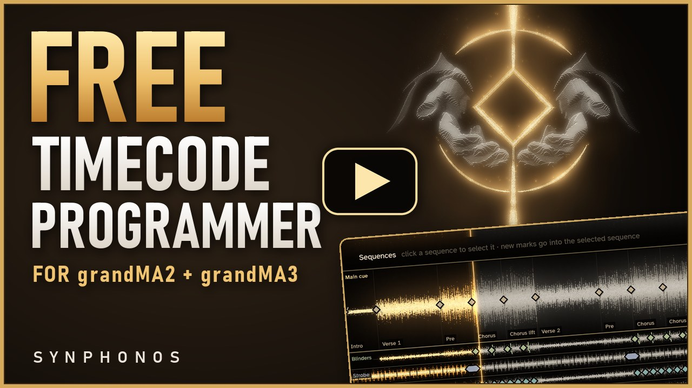
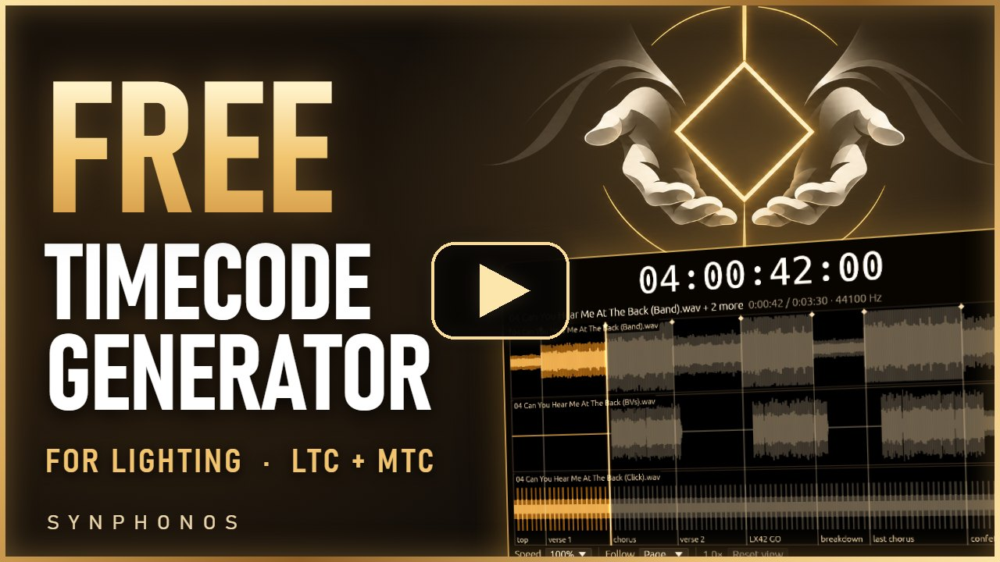
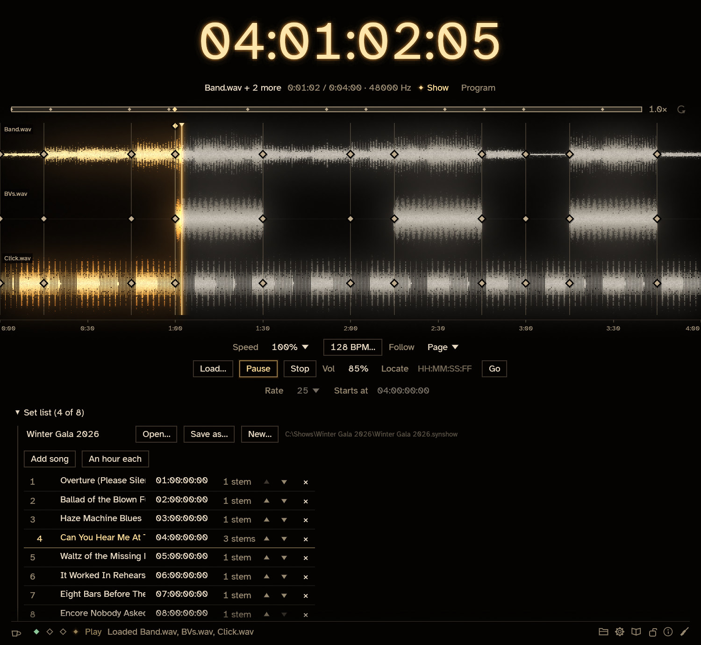
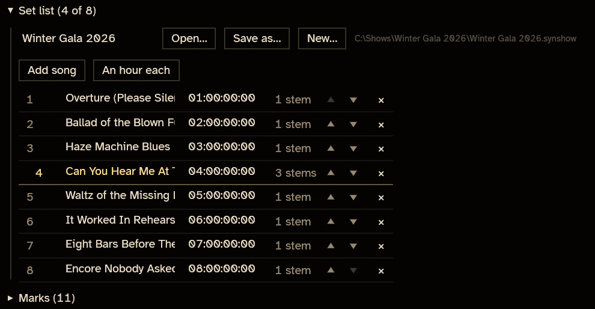
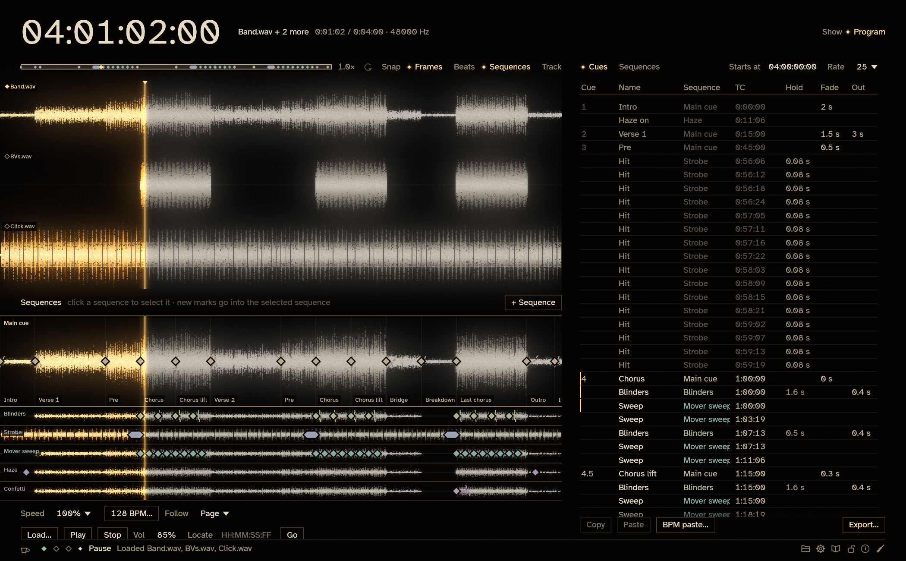
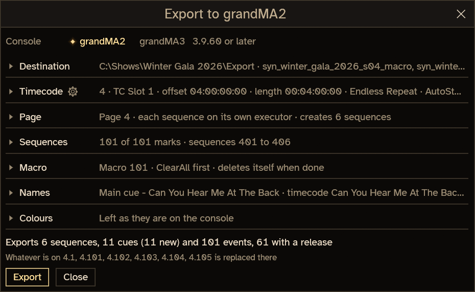

<div align="center">


# Synphonos

**A timecode generator that plays the show.**

Synphonos plays your audio and sends SMPTE timecode locked to where that audio has
got to. Press Play, and the console follows. Since 1.1 it also holds your cues: place
them on the song, and export them to grandMA2 or grandMA3.

[**Download for Windows**](../../releases/latest) · [Watch the videos](#see-it-run) · [What it does](#what-it-does) · [Quick start](#quick-start) · [Programming a console](#programming-a-console) · [If something goes wrong](#if-something-goes-wrong)

Windows 10/11 · 64-bit · one file · free

</div>

---

## See it run

Two short videos, from the download to the desk following the music.

<table>
<tr>
<td width="50%" valign="top">
<a href="https://www.youtube.com/watch?v=IdgJ8q4Xi3k"></a>
<p><b>New in 1.1</b> · 3:31<br>
Place the cues on the song, then send them to the desk: sequences, marks and BPM
paste, then the export. One command pasted into grandMA2, and the desk runs the cues
with the music. <a href="https://www.youtube.com/watch?v=IdgJ8q4Xi3k">Watch on YouTube</a></p>
</td>
<td width="50%" valign="top">
<a href="https://www.youtube.com/watch?v=pcTgkhOVEvU"></a>
<p><b>Recorded on 1.0</b> · 2:59<br>
Download it, load a song, set up the timecode in grandMA2, and press Play. The window
looks different in 1.1, and the output settings are now behind the cog in the bottom
right corner. <a href="https://www.youtube.com/watch?v=pcTgkhOVEvU">Watch on YouTube</a></p>
</td>
</tr>
</table>

## Download

**[Get the latest release](../../releases/latest)**: one zip,
`Synphonos-1.1.0-windows-x64.zip`, about 20 MB, holding three files:

| File | What it is |
|---|---|
| `synphonos.exe` | The program. One self-contained file, about 20 MB. |
| `LICENCE.txt` | The licence, terms and privacy notice. Keep it with the exe: its own section 2 asks anyone passing the program on to include it. |
| `Synphonos - How to use.pdf` | The manual: 132 pages, from a ten-step quick start to what every line of an exported macro does, with every picture taken from the running program. |

There is no installer. Unzip it into a folder of its own (a folder on the show
machine's desktop is fine) and double-click the program. Nothing is installed, no
runtime is needed, no registry keys are written, and deleting the folder removes it.

> **SmartScreen.** The program is not code-signed yet, so Windows may warn you the
> first time you run it. *More info* → *Run anyway*. To be sure the zip is the one
> published here, check its SHA-256 first: the release page gives it, with the one
> command that prints it.

On the first run the licence appears as a gate that has to be accepted before the
program can be used. You are asked once, and again only when a later version changes
the terms. 1.1 does: if you accepted them in 1.0 you are shown them once more, with
what changed at the top.

**Coming from 1.0?** Read [Shows from 1.0](#shows-from-10) before you open a show on
the new version.

## What it does

A lighting or video desk that runs from timecode needs something to tell it what time
it is. Synphonos is that something, and it is also the thing playing the music, which
is the point. The timecode is not synchronised to the audio; it is **counted from it**,
one sample at a time, in the same audio callback that fills the output buffer. There is
nothing to line up and nothing that can drift.

It sends timecode two ways, and you can use either or both at once:

- **LTC**: longitudinal timecode, as audio, on a channel of the same output device.
  Plug that channel into the desk's timecode input.
- **MTC**: MIDI timecode, as quarter-frame messages, out of a MIDI port. On Windows
  that usually means a virtual port such as loopMIDI, to another program on the same
  machine.

<div align="center"></div>

The window has two modes, and timecode goes out the same way in both:

- **Show** runs the show: the set list, your own marks to find your way, the transport.
- **Program** places the marks a console fires as cues, in sequences, and exports them.

### What it is not

Synphonos is a **generator only**. It will not chase timecode coming in from somewhere
else, it will not free-run without a file, and it will not loop. If you need a machine
that follows another machine, this is the wrong tool, and [what it won't do](#what-it-wont-do)
is an honest list of the rest.

### What you need

- A Windows 10 or 11 machine, 64-bit.
- An audio output with a spare channel for LTC, or a MIDI port for MTC.
- A desk that reads timecode, set to the same frame rate.
- Your show's audio, in any ordinary format.

No installer, no runtime, no licence key, no internet connection.

## Quick start

1. **Run it.** Click through the start-up animation and accept the terms.
2. **Load a song:** drop an audio file on the window, or press *Load…*.
3. **Open the output settings:** the cog in the bottom right corner, then *Output*.
   Pick your audio interface under *Device*, and leave *LTC* ticked. On a two-channel
   device the song plays on channel 1 and LTC on channel 2; with more channels the
   song is on 1 and 2 and LTC on 3. Patch the LTC channel into the desk's timecode
   input.
4. **Set *Rate* and *Starts at*.** The rate must match the desk's (24, 25, 29.97 NDF,
   29.97 DF or 30). *Starts at* is the timecode at the first sample of the song:
   `01:00:00:00` is a common choice.
5. **Press Play.** The readout turns gold and runs, and the desk should lock.

For MTC instead of LTC, see [MTC on Windows](#mtc-on-windows-loopmidi).

LTC is a harsh buzz. Keep its channel out of the PA and out of your headphones.

> **Before the doors open:** play a song, watch the desk take the timecode, lock the
> show. That three-step check catches the rate, the routing and the port, which between
> them are almost every problem anyone has.

## Running a show

**The set list.** A *show* is the whole evening: an ordered list of songs, each with its
own stems, its own start and its own marks. Click a song's number to load it, or
give *Previous song* and *Next song* keys and run the set from the lighting console.
*An hour each* puts song 1 at `01:00:00:00`, song 2 at `02:00:00:00` and so on, so one
song's cues can never match another's.

<div align="center"></div>

**Show files.** *Save as…* writes a `.synshow`: the set list, the stems, the starts,
the marks, and in 1.1 the sequences and cues. The device, the port, the keys and the
look stay in the machine's own settings, so a show copies to a **backup rig** without
dragging the first machine's device names with it. Each stem is stored as an absolute
path *and* relative to the show file, so a show folder copied to another drive finds
its own audio. Every change is saved within a second.

**Stems.** Up to 8 files play together as one song: the instrumental, the BVs, the MD
track. They share a transport, a position and one set of timecode, so there is nothing
to line up. Each gets a mute, a level and its own channels, so a stem can go to the desk
separately. Different lengths are fine. A stem whose file has gone missing stays in the
show as *not found*: put the file back and press *Look again*.

**Marks.** Named points in the song (*verse 1*, *last chorus*), saved with it and back
when it loads. Page Up and Page Down step between them, and any mark can be given a key
that goes straight to it. These are Show mode's own marks, for finding your way; the
marks a console fires live in Program mode.

**The waveform.** Every stem, drawn as fine glowing grains: what has played is gold,
what is to come is ivory. Click to move the playhead. A zoom bar above the stems shows
the part of the song in view; Ctrl+scroll zooms in until one frame is 24 points wide,
Shift+scroll moves along, and Alt+scroll sizes one stem. *Follow* decides what a
zoomed-in view does while playing: *Page*, *Smooth* or *Stay put*.

**Speed.** 10% to 200%, like a tape: the pitch moves with it. Timecode keeps to the
track: at 50%, one second of timecode takes two seconds, LTC comes out at half speed and
MTC quarter-frames half as often.

**Keys, including from other apps.** Every transport action can be given two keys. Turn
on *Ticked keys work from other apps*, tick a key, and it works while **another program
has the keyboard**, so the set runs from grandMA onPC without touching the timecode
machine. Ticked keys show in gold, and Synphonos hands them back whenever its own window
is in front.

**The lock.** The padlock in the bottom right corner runs the show without letting
anything change it. Play, pause, jumps, marks, *Next song* and the levels keep working;
stems, marks, starts, the frame rate, the output's Track and LTC channels, the running
order and every edit in Program mode are frozen. **Stop asks twice**, because Escape is the key a hand reaches
for by reflex. It survives a restart: a show machine left locked comes back locked.

**The window remembers.** Its size and place, Show or Program, the show, the song and
the playhead. The *Files* window (the folder in the bottom right corner) says where the
show and the settings are kept, lists the last eight shows, and can move either
somewhere else.

**The look.** Six presets (Gold, Ember, Rose, Verdant, Moonlight, Mono), or set the
accent, ground and text yourself and everything else follows. Glow, scale, density and
waveform height are all adjustable, as is how much of the start-up animation plays.

## Programming a console

New in 1.1. Program mode keeps the readout, the stems and the transport, and turns the
lower half of the window into sequences, a cue table and the tools to edit them.

<div align="center"></div>

**Sequences.** Each one stands for a sequence on the console: the main cue list, a
strobe button, the blinders. A sequence has a name, a colour, a function (Goto, Go+,
Go-, Top, Pause, Temp, Flash, Swop, Toggle, On, Off), an executor and a default hold.
A show holds up to 32, and every song of the show uses the same ones.

**Marks.** A mark is a moment the console does something: the next cue of a cue list,
or the press and release of a button. Press M at the playhead or double-click in a
sequence; drag to move, drag a box to select several. Marks land on timecode frames,
or on beats with *Snap* set to *Beats*.

**Cue numbers.** In a Goto sequence every mark is a cue with a number. A cue placed
between 2 and 3 becomes 2.5, and no number ever changes by itself. Type a number the
sequence already has and that mark fires the same cue again, so a second verse goes
back to the verse look.

**The cue table** lists the song's marks in time order: cue, name, sequence, time,
hold, fade and out. The selected row is edited in place, and a change made with several
marks selected changes them all. While the song plays, the table follows the playhead.

**Tempo and the beat grid.** *Set BPM* takes a typed tempo (20 to 400), a tapped one,
or detects it from a stem. Beat and bar lines then run through the stems and the
sequences.

**Copy, paste and BPM paste.** Marks copy from one song to another and keep their
spacing. *BPM paste* repeats the copied marks at a tempo (every quarter beat, beat, bar
and so on) for a number of beats, bars or seconds. Each copy is placed from the start,
never from the copy before, so bar 64 is as exact as bar 1. Undo goes back 200 steps.

**Cue times.** Each cue can have a fade, an out fade, a delay, an out delay, a mode
(Normal, Assert, X-Assert or Release), a command and an info line, and each sequence an
Off time. Leave a time empty and the console keeps its own. Fades are drawn as dashed
lines over the sequences, so you can see where the light is gone.

### Export to grandMA2 and grandMA3

*Export…* writes the loaded song as two files: a macro, and the timecode it imports. A
switch at the top of the window picks **grandMA2** (3.9.60 or later) or **grandMA3**.

<div align="center"></div>

- **Where the files go:** straight into grandMA onPC on the same PC, onto a USB drive
  laid out for a console, or into a folder to copy over by hand.
- **Nothing reaches the console until you run the macro there.** The window shows the
  commands to type afterwards, with a button that copies them.
- **What the macro does:** stores each new cue of a Goto sequence, empty, for you to
  fill; labels the cues and the sequences; puts each sequence on its executor and sets
  the button to the sequence's function; imports the timecode; and deletes itself.
- **Exporting again keeps your looks.** Synphonos remembers which cues it has stored.
  The next export stores only the new ones, relabels the rest and updates every time.
- **Cue commands go out only when ticked.** A command is something the console runs
  each time its cue fires, and a show from someone else can carry ones nobody at the
  desk has read. The window lists them in full, under a tick that is off every time it
  opens.
- **It is one song at a time,** and it writes files: sending to a console over the
  network is not built.

> **Tried on onPC, not yet on a real console.** On grandMA3 the whole export, and
> playback from a timecode slot, were run on onPC 2.4.2 and 2.5.1, and on 2.4.2 with
> Synphonos's own MTC arriving through a loopMIDI port. On grandMA2 the import works on
> onPC 3.9.63; the macro running to its end, events firing at their times, and cue
> times, have not been checked there yet. The manual says what is untried, chapter by
> chapter and in one table, and [CHANGELOG.md](CHANGELOG.md) lists it under *Known
> issues*. If you run an export on a console, please say how it went.

## MTC on Windows: loopMIDI

Windows has no built-in virtual MIDI ports. To send MTC to another program on the same
machine, install [loopMIDI](https://www.tobias-erichsen.de/software/loopmidi.html) (or a
similar virtual MIDI driver), create a port in it, then select that port in Synphonos and
as the MTC input in the receiving program. Hardware MIDI interfaces appear in the list
directly.

The program explains this itself: **Set up a MIDI port…** in *Settings*, *Output* walks
through the steps and opens the loopMIDI download page. loopMIDI's driver is not packaged
inside Synphonos, because its licence does not allow that, so it is installed separately.

grandMA3 onPC takes no MIDI from the PC until its *MIDI from wing* setting is switched
off. The manual's grandMA3 chapter has the steps.

## Specifications

| | |
|---|---|
| **Timecode out** | LTC (audio, −20 to 0 dBFS, default −10) and MTC (quarter-frames, trim −8 to +8 frames). Either or both, switchable while playing. |
| **Frame rates** | 24, 25, 29.97 NDF, 29.97 DF, 30. Not 23.976. |
| **Audio formats** | WAV, AIFF, FLAC, Ogg Vorbis, MP3, AAC (`.m4a`, `.mp4`, `.aac`), MKV/WebM audio. Sample rates from 8 kHz to 768 kHz. |
| **Audio out** | WASAPI shared mode, at the device's default sample rate. Not ASIO. |
| **Limits** | 8 stems per song, 200 songs and 32 sequences per show. |
| **Speed** | 10, 25, 50, 75, 100, 125, 150 or 200%. |
| **Tempo** | 20 to 400 BPM. *Detect* finds 50 to 220. |
| **Console export** | grandMA2 3.9.60 or later; grandMA3, tried on 2.4.2 and 2.5.1. Not at 29.97 DF: neither console's timecode has drop-frame. |
| **Settings** | `%APPDATA%\tcgen\config`: settings, the default show and `crash.log`. The *Files* window can move them. |
| **Network** | None. It makes no connections at all. |

The config folder keeps the program's old name (`tcgen`) on purpose, so a machine that
ran an earlier version keeps its settings, and a grandMA2 patch expecting the `tcgen MTC`
port carries on working.

### Default keys

| Action | Key | | Action | Key |
|---|---|---|---|---|
| Play / Pause | Space | | Back to play start | Backspace |
| Stop | Escape | | Go to start | Home |
| Jump back / forward | Left / Right | | Add mark | M |
| Previous / next frame | `,` / `.` | | Previous / next mark | PgUp / PgDn |

*Play*, *Pause*, *Speed down*, *Speed up*, *Return on pause*, *Previous song*, *Next song*
and *Lock the show* have no default key: every sensible key is already doing something,
and which ones matter depends on the show. Give them keys in *Settings*, *Keys*, and
tick them if the set is to be run from the console.

Program mode adds editing keys of its own: Ctrl+C, Ctrl+X and Ctrl+V; Ctrl+Z to undo and
Ctrl+Y to redo; Delete; Ctrl+← and Ctrl+→ to nudge the selection a frame, with Shift a
second; and Ctrl+A for every mark in the selected sequence.

### Command line

```
synphonos                                            open the window
synphonos --version
synphonos --help
synphonos --selftest                                 timecode core checks; exit 0 or 1
synphonos --render-ltc out.wav 01:00:00:00 25 30     30 s of LTC as a 48 kHz WAV
synphonos --tempo song.wav                           what Detect would find in a file
```

All but the first run headlessly: no window, no audio device, no MIDI port.

## What it won't do

Better to read this now than to find out at the production meeting.

- Chase or slave mode: it generates timecode, it never follows it.
- Free-run without a file, and looping.
- Audible scrubbing, and pitch-preserving speed change.
- 23.976 fps. ASIO. Split output devices.
- Changing song stops playback: it is a load, not a segue.
- Stems cannot be moved in time against each other, or reordered.
- Send to a console over the network, or export every song at once.
- Keys from other apps are Windows only.

**Worth knowing about files.** MP3 encoder delay and padding are removed from the LAME
header, so `00:00:00:00` is the first real sample. AAC priming is *played*, so with
typical encoders the music starts about 23 ms late in `.m4a` and ADTS AAC: use WAV,
FLAC or MP3 where that matters. Seeking in MP3 and AAC may land a few milliseconds off;
WAV and FLAC are exact.

## Shows from 1.0

- **1.1 saves shows in a new format, which 1.0 cannot open.** A show saved by 1.0 opens
  in 1.1 as it was: its marks stay Show mode's marks, and Program mode starts empty with
  one sequence, *Main cue*. From then on it is saved in the new format. Keep a copy of
  the 1.0 file for any machine still on 1.0.
- **1.0 refuses a 1.1 show and leaves the file alone.** It says the file is not a
  readable show file and carries on without it.
- **Update every machine before sharing a 1.1 show,** the backup rig included.
- **Use one version on a machine.** 1.0 and 1.1 share one settings file, and 1.0 saves
  it with only what it knows, so 1.1's recent shows, window place and mode are forgotten.
  *New* in 1.0 also starts its empty show over the default show. Remove 1.0 once 1.1 is
  in use, and keep every show in a file of its own with *Save as…*.

## If something goes wrong

| What you see | What to do |
|---|---|
| The desk will not lock to LTC | LTC is sent only while the song plays. Check *LTC* is ticked in *Settings*, *Output*, that its channel is the one cabled to the desk's timecode input, and that the frame rate matches the desk. Raise the level a few dB from −10. |
| The second diamond is red | MTC is on with no working port. Click the diamond: the help window walks through installing loopMIDI and making a port. |
| The third diamond is red | Windows refused a ticked key, usually because another program holds it. The status bar says which; pick a different key. |
| Keys do nothing at all | A text field has the keyboard. Click the window background. |
| The first diamond is red | No audio device is open. Plug the interface back in and press ↻ beside *Device* in *Settings*, *Output*. |
| Audio stutters, timecode with it | The machine is not keeping up. Close what else is running; this is one of the few programs that genuinely wants the machine to itself. |
| Cues drift through the night | The frame rate does not match the desk's. It is nearly always this. |
| A song says *not found* after its stems | A stem's file has moved or been renamed. The show keeps it: put the file back and press *Look again* in *Settings*, *Tracks*. |
| Every cue is early or late by the same amount after an export | *Offset* in the Export window's *Timecode* part should be the song's *Starts at*. |
| Synphonos 1.0 says a show is not a readable show file | The show was saved by 1.1. Update that machine. |
| It fell over | It writes what happened to `crash.log`, beside its settings, and tells you where. Send that, with **Copy diagnostics** from the About window. |

The manual in the download has every one of these in full, and a chapter on what is
known to be wrong. If you are still stuck, write to contact@synphonos.com, or
[open an issue](../../issues) with the output of *Copy diagnostics*. Issues are public:
read what you paste first. The diagnostics name your audio device and MIDI port, and
the last message may name a file.

## Licence, privacy and donations

Synphonos is **free**. Install it on as many machines as you like, use it commercially,
and pass the unchanged program on to whoever you want, with `LICENCE.txt` alongside it.
It comes with no warranty: it is a tool for live work, and deciding whether to trust it
with a show, testing it first, and having a fallback if it stops, are yours to do.

It **makes no network connections and collects nothing**, about you or about your show.

This repository is the download and the documentation. Synphonos is free to use but is
not open source, and the source is not published here. The full terms are in
[`LICENCE.txt`](LICENCE.txt), which is the same document that ships in the zip; the
documentation and the artwork in this repository are © 2026 the author of Synphonos, all
rights reserved. It is built from open-source components: every one of them, the licence
it is used under and that licence in full are listed in
[`THIRD-PARTY-NOTICES.txt`](THIRD-PARTY-NOTICES.txt), and under **Licences and
third-party notices** in the About window. The audio decoder,
[Symphonia](https://github.com/pdeljanov/Symphonia), is compiled in unmodified under the
MPL-2.0, and the notices carry the offer of its source at the exact version used.
What changed in each version is in [`CHANGELOG.md`](CHANGELOG.md).

If it saved your evening, [buy me a coffee](https://buymeacoffee.com/synphonos). Donations
are gifts, not purchases: nothing is unlocked and nothing is withheld.
